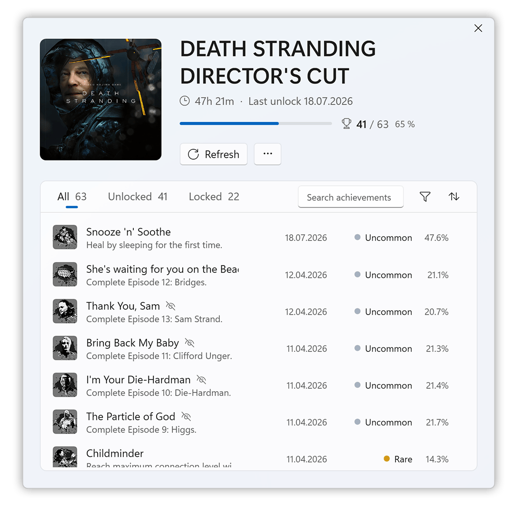
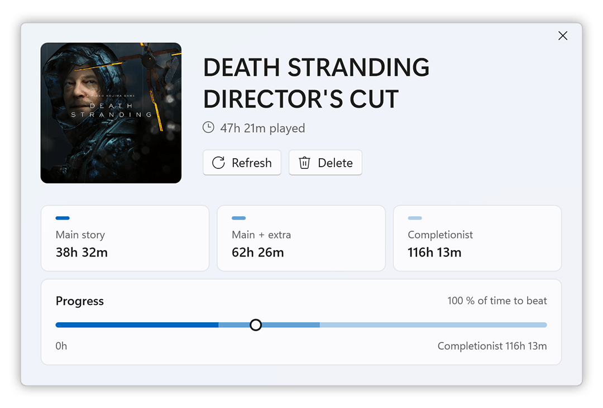

  

Fluent 11 is a desktop theme for [Playnite](https://playnite.link) inspired by Windows 11: Fluent colors, Segoe UI Variable, rounded corners and Mica.

**Install it together with Fluent 11 Helper.** The helper add-on is needed and brings most of the look and features.

Light on resources.

---

## Light & Dark

Switches between light and dark live with Windows, no restart needed.

 

## Accent color

Uses the accent color you picked in Windows, in light and dark.

 

## Game details

In the grid view, the game details open as an overlay over your library.

Description, details, screenshots, achievements and time to beat, all on one page.

 

## Built-in pages

<table>
  <tr>
    <td width="33%" valign="top">
      
      
<b>Insights</b> Statistics for your library: play time, completion, sources and more.

    </td>
    <td width="33%" valign="top">
      
      
<b>Achievements</b> Achievements of all games in one list. Needs Playnite Achievements.

      
Also redesigns the achievements window of a single game.

      
    </td>
    <td width="33%" valign="top">
      
      
<b>Time to Beat</b> HowLongToBeat times next to your play time. Needs HowLongToBeat.

      
Also comes with its own time to beat window for a single game.

      
    </td>
  </tr>
</table>

## More features

- Controls, right-click menu and dialogs rebuilt in the Windows 11 style
- Mica background
- Covers that grow and shrink with the window
- Dialogs and add-on windows open centered over Playnite
- Screenshots in the game details (with Screenshot Utilities)

**Experimental**

- 3:4 poster covers in desktop mode, with your own cover per game
- Acrylic menus
- Smoother scrolling with momentum for touchpads (so far only tested with an Apple Magic Trackpad)
- Crop black bars from screenshot thumbnails
- Steam reviews and system requirements in the game details

<b>Settings</b>

 

  
  

  
  

All options are in **Add-ons (F9) > Extension settings > Generic > Fluent 11 Helper**.

---

## Installation

1. Download **Fluent 11** (`.pthm`) and **Fluent 11 Helper** (`.pext`) from the [latest release](https://github.com/Arstidir/Fluent11/releases/latest).
2. Drag both files onto the Playnite window, or open them with Playnite.
3. In Playnite, open **Settings > Appearance** and choose **Fluent 11** as the desktop theme.
4. Restart Playnite.
5. For the best look, set **Settings > Appearance > Font** to **Segoe UI Variable Text** (comes with Windows 11).

**Optional add-ons:** [Playnite Achievements](https://github.com/justin-delano/PlayniteAchievements), [HowLongToBeat](https://github.com/Lacro59/playnite-howlongtobeat-plugin), [Screenshot Utilities](https://github.com/HerrKnarz/Playnite-Extensions)

## Requirements

- Windows 11
- Playnite 10

## AI assistance

Fluent 11 and Fluent 11 Helper were built with the help of AI (Claude by Anthropic). Every change was reviewed and tested by hand.
