

  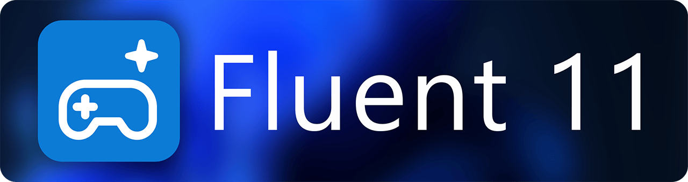

<h3 align="center">A Windows 11 inspired theme for Playnite.</h3>

  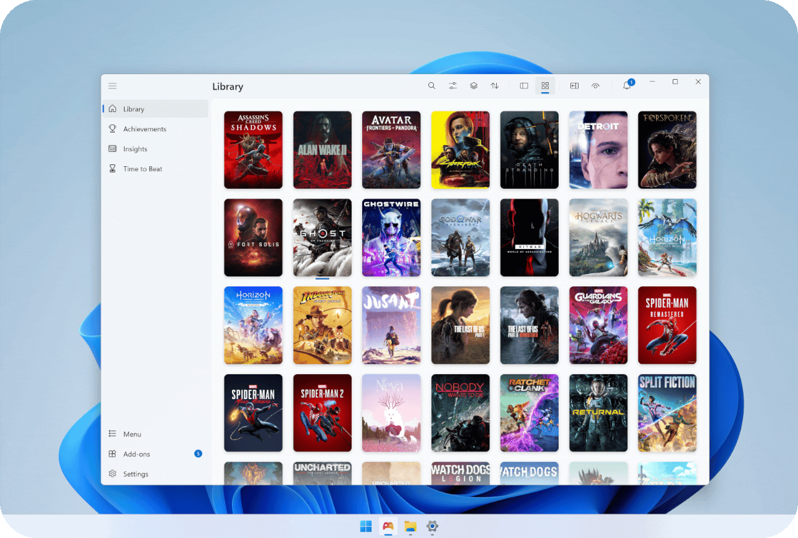

Fluent 11 is a desktop theme for [Playnite](https://playnite.link) inspired by Windows 11: Fluent colors, Segoe UI Variable, rounded corners and Mica. It comes with **Fluent 11 Helper**.

Light on resources.

---

## Light & Dark

Switches between light and dark live with Windows, no restart needed.

  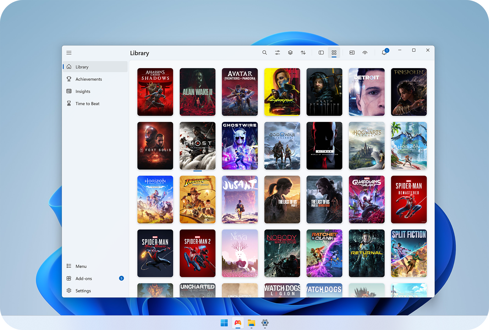
  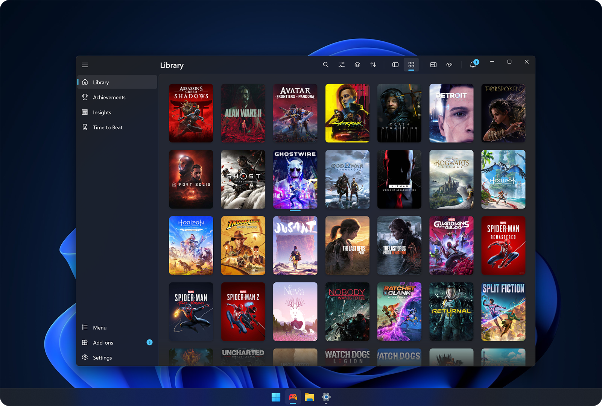

## Feels like Windows 11

Controls are rebuilt in the Windows 11 style: buttons, toggles, checkboxes, sliders, menus, tooltips and dialogs.

## Accent color

  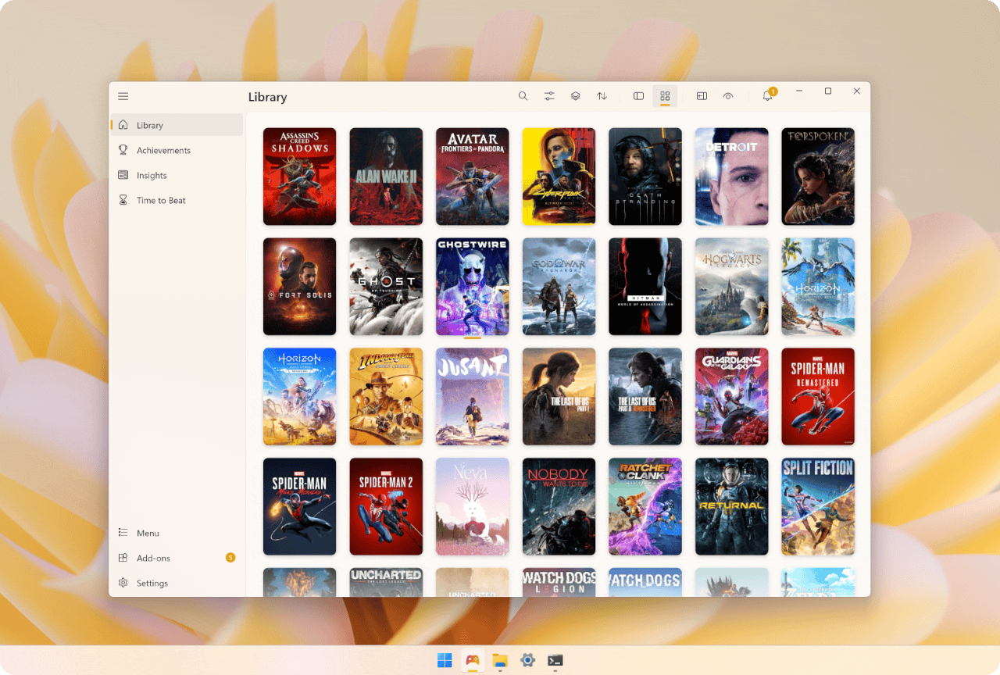

Uses the accent color you picked in Windows, in light and dark.

## Built-in pages

<table>
  <tr>
    <td width="33%" valign="top">
      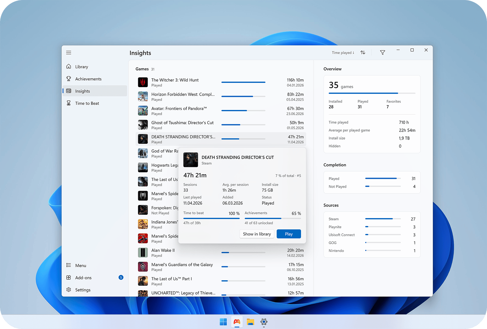
      
<b>Insights</b> Statistics for your library: play time, completion, sources and more.

    </td>
    <td width="33%" valign="top">
      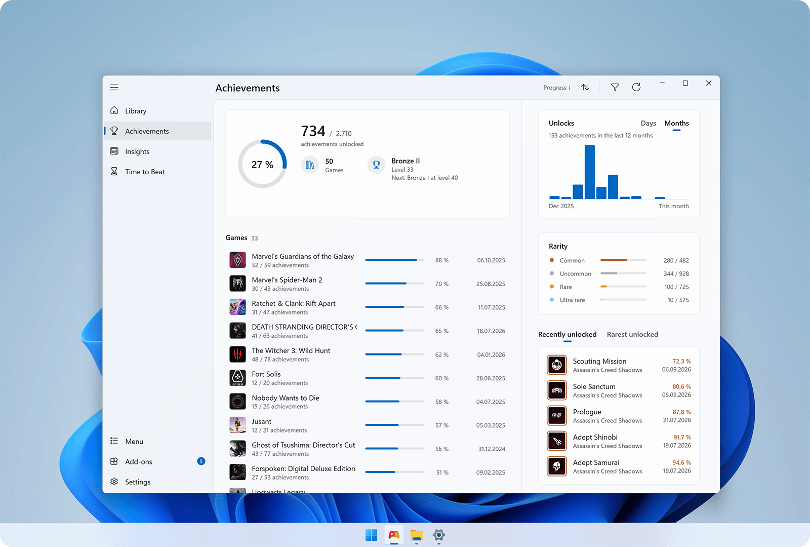
      
<b>Achievements</b> Achievements of all games in one list. Needs Playnite Achievements.

    </td>
    <td width="33%" valign="top">
      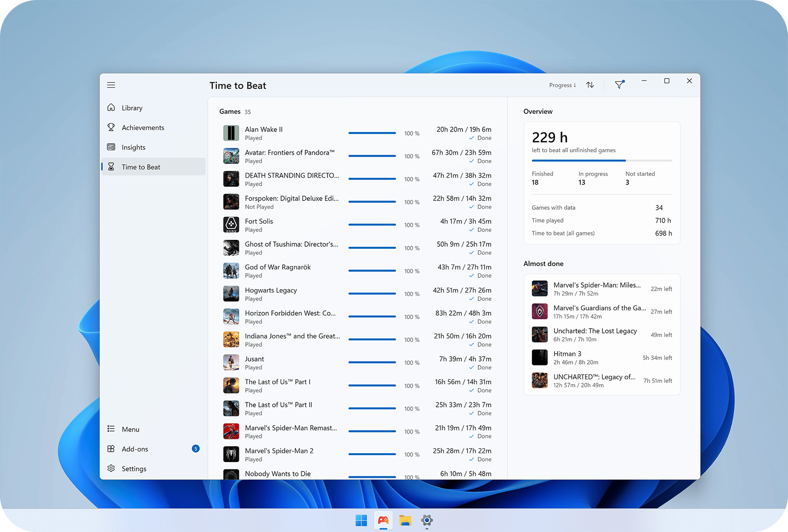
      
<b>Time to Beat</b> HowLongToBeat times next to your play time. Needs HowLongToBeat.

    </td>
  </tr>
</table>

<b>More screenshots</b>

 

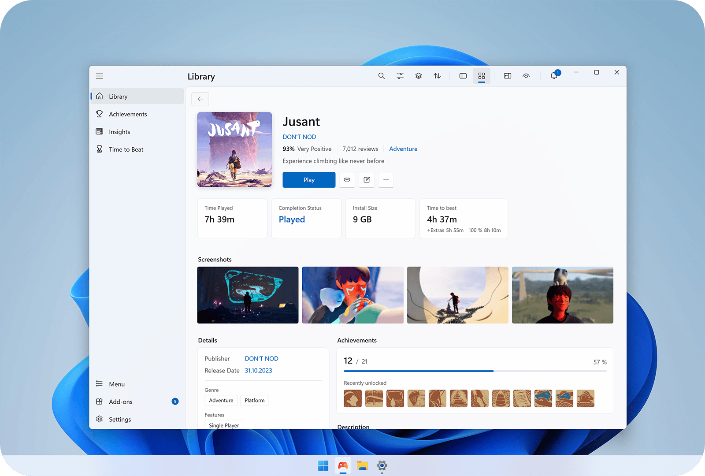

---

## Features

**Look**
- Light and dark, automatic with Windows or fixed
- Windows accent color
- Mica background

**Library**
- Covers that fit the window
- Game details as an overlay in the grid view
- Screenshots in the game details (with Screenshot Utilities)

**Menus & windows**
- Right-click menu like in Windows 11
- Dialogs and settings windows in the Windows 11 style

**Pages**
- Insights, Achievements and Time to Beat

**Experimental**
- Steam reviews and system requirements in the game details
- Acrylic menus

---

## Settings

  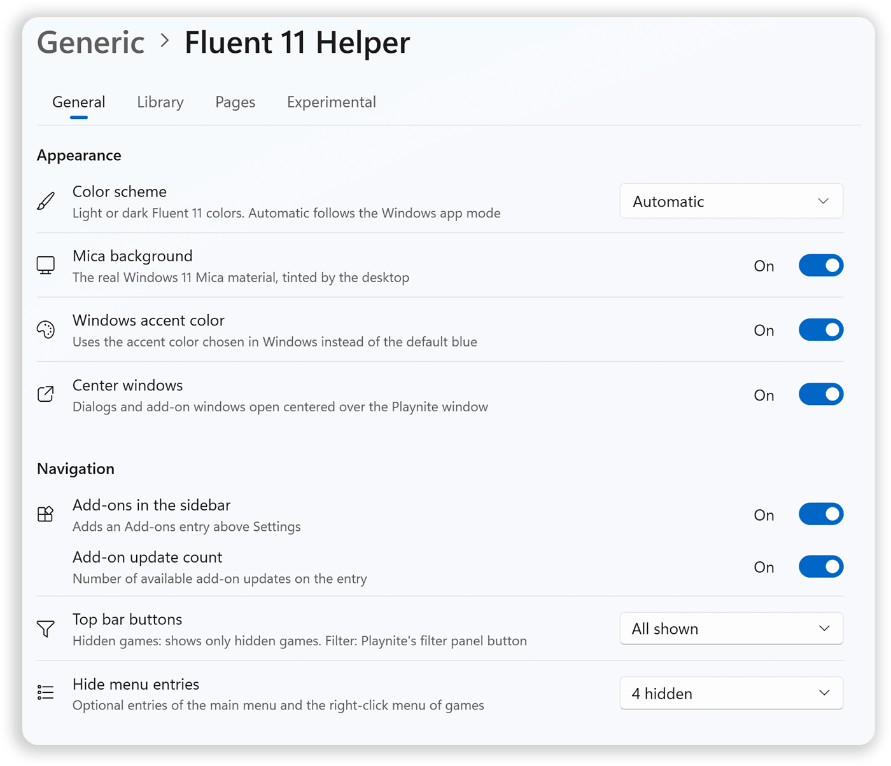
  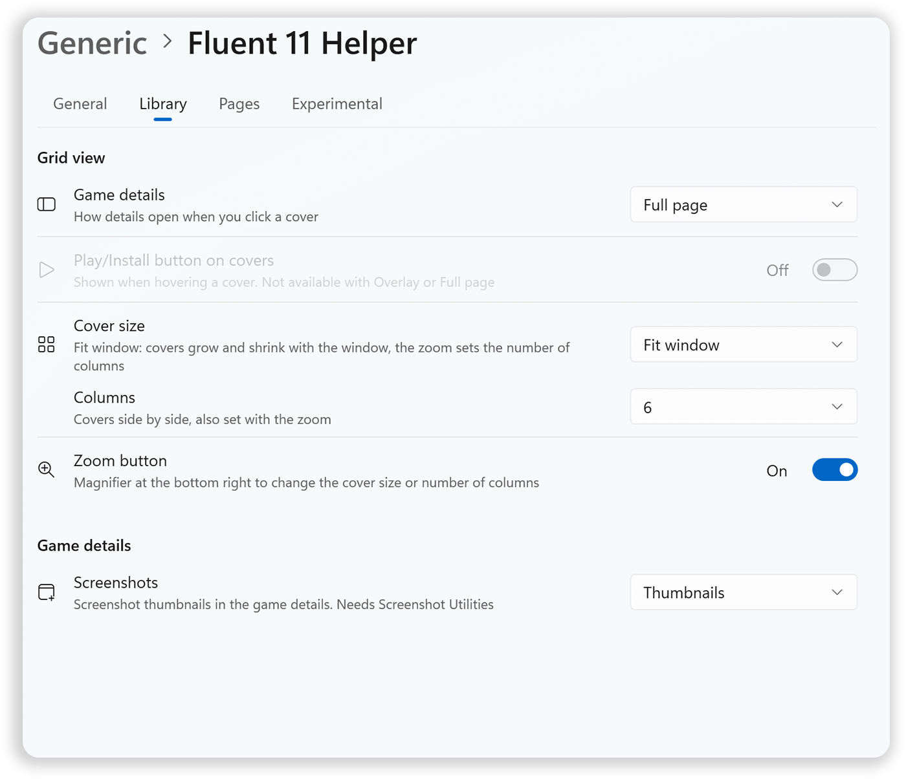

  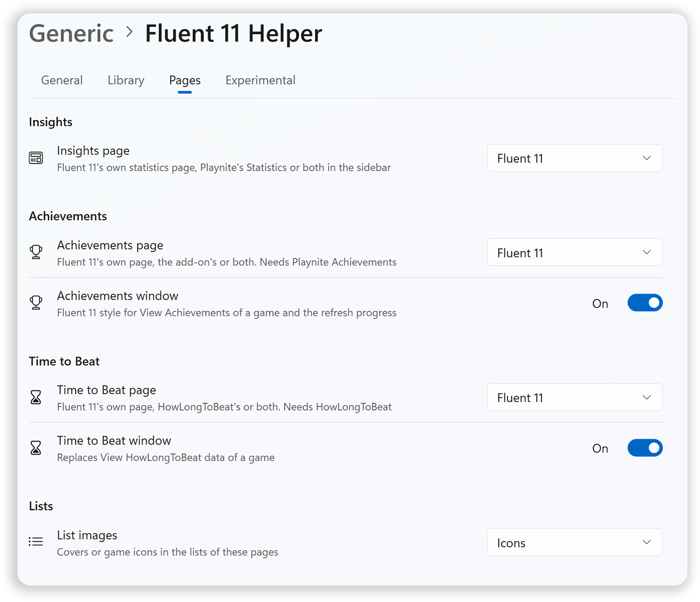
  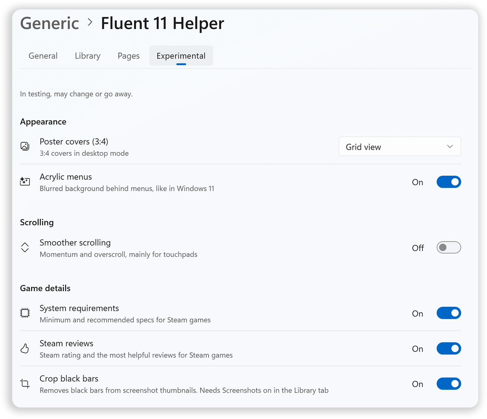

All options are in **Add-ons (F9) > Extension settings > Generic > Fluent 11 Helper**.

## Installation

1. Download **Fluent 11** (`.pthm`) and **Fluent 11 Helper** (`.pext`) from the [latest release](https://github.com/Arstidir/Fluent11/releases/latest).
2. Drag both files onto the Playnite window, or open them with Playnite.
3. In Playnite, open **Settings > Appearance** and choose **Fluent 11** as the desktop theme.
4. Restart Playnite.

**Optional add-ons:** [Playnite Achievements](https://github.com/justin-delano/PlayniteAchievements), [HowLongToBeat](https://github.com/Lacro59/playnite-howlongtobeat-plugin), [Screenshot Utilities](https://github.com/HerrKnarz/Playnite-Extensions)

## Requirements

- Windows 11
- Playnite 10 (latest version)

## AI assistance

Fluent 11 and Fluent 11 Helper were built with the help of AI (Claude by Anthropic). Every change was reviewed and tested by hand.
